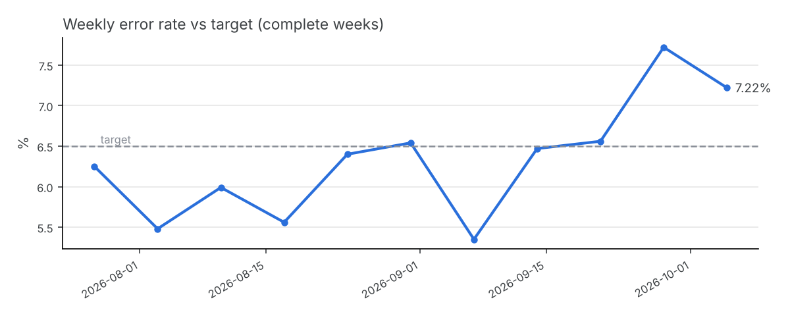
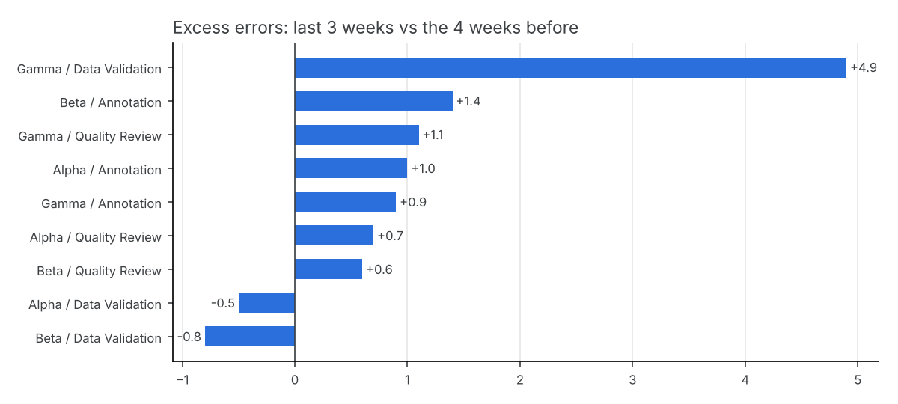

# Automated Weekly Business Review (WBR)

Version 2 of this project. v1 is the [Google Sheets dashboard](https://docs.google.com/spreadsheets/d/1JMYr6Crc37rYLAKmLGatFd8JOZos8KqSbY_yd6HPihk/edit?usp=sharing):
a 4-week snapshot that found Team Gamma and Data Validation had the highest
error rates, and recommended four next steps. **v2 carries out those four
steps and turns them into a weekly routine** that refreshes in one command.

| v1 recommended action | What v2 does |
|---|---|
| Investigate error patterns in Data Validation | Dive deep traces the extra errors to team x category |
| Review Team Gamma's workflow | Team view and dive deep both point at Gamma |
| Compare weekly completion and error-rate trends | Week-over-week change, 4-week average, targets |
| Validate source data before reporting | Data-quality checks first, plus a reconciliation of every v1 figure |

```bash
pip install -r wbr/requirements.txt
python wbr/refresh_wbr.py        # builds the WBR pack in wbr/outputs/
pytest wbr/tests                 # checks the KPI math and the v1 reconciliation
```

## Same data as v1, now at task level

v1 published totals only. v2 rebuilds the task-level rows behind them (same 3
teams, same 3 categories) so they add up **exactly** to v1: 1,125 assigned,
1,045 completed, 92.89% completion, 7.27% error rate, Gamma 89.12% / 9.84%,
Data Validation 9.84%. It adds 8 earlier weeks (27 Jul - 14 Sep) as a baseline.

## What this week's refresh found

From [`outputs/WBR_summary.md`](outputs/WBR_summary.md), week of 5 Oct 2026 (latest complete week):

- Error rate **7.22%**, above the 6.50% target for 3 weeks running.
- The dive deep traces **46%** of the extra errors to **Team Gamma / Data
  Validation**: its error rate doubled from 10.39% (prior 4 weeks) to 20.41% (last 3 weeks).
- The week of 12 Oct has only 2 of 5 working days. v1 compared it with full
  weeks; v2 shows it but leaves it out of week-over-week comparisons.
- **v1 reconciliation: 13 of 17 figures match. The 4 that don't reveal a
  formula inconsistency in v1:** the Weekly_Metrics tab divides errors by tasks
  *assigned* (6.15%, 7.16%, 6.67%, 7.33%), while the dashboard headline (7.27%)
  and team figures divide by tasks *completed*. On one definition, the weekly
  error rates are 6.56%, 7.72%, 7.22% and 7.97%.




## How it works

| Step | File | What it does |
|---|---|---|
| 1. Validate | `sql/01_data_quality_checks.sql` | Flags duplicates, missing fields, negative counts and impossible totals |
| 2. Clean | `sql/02_clean_tasks_view.sql` | One trusted view; failing rows excluded |
| 3. Trend | `sql/03_wbr_weekly_trend.sql` | Weekly KPIs, partial-week flag, WoW (`LAG`), 4-week average, vs target |
| 4. Teams | `sql/04_wbr_team_latest_week.sql` | Which team moved in the latest complete week |
| 5. Dive deep | `sql/05_dive_deep_error_drivers.sql` | Excess errors by team x category, last 3 weeks vs the 4 before |
| 6. Reconcile | `sql/06_v1_reconciliation.sql` | Recomputes every v1 figure and flags differences |
| 7. Publish | `refresh_wbr.py` | Excel WBR, written callouts, charts, Google Sheets tabs, clean extract |
| 8. Automate | `.github/workflows/wbr-refresh.yml` | Tests + refresh every Monday 08:00 IST, on push, or on demand |

## Outputs (`wbr/outputs/`)

- `WBR_<week>.xlsx`: Summary, Weekly Trend, Teams, Dive Deep, v1 Reconciliation, Data Quality
- `google_sheets/WBR_v2_*.csv`: the same sections, ready to add to the v1 Sheet
  as new tabs (**File > Import > Upload > Insert new sheet**), so the Sheet stays
  the dashboard stakeholders use
- `charts/*.png` and `WBR_summary.md`
- `wbr_dataset_clean.csv`: clean task-level extract to connect to QuickSight or Tableau

The SQL is PostgreSQL syntax. The refresh runs it through DuckDB on the CSV
files, so anyone can reproduce it without a database server.

## How this maps to a Business Analyst role

| Role need | Where it is |
|---|---|
| Maintain and refresh WBRs | `refresh_wbr.py`, one command; scheduled in GitHub Actions |
| Build reports and dashboards | Excel WBR pack, Google Sheets tabs, charts |
| Dive-deep requests and root cause | `05_dive_deep_error_drivers.sql`, excess-error method |
| Validate data accuracy | Data-quality checks, partial-week handling, v1 reconciliation, unit tests |
| Change existing analytical frameworks | v2 extends v1 and corrects its error-rate definition |
| Automate existing processes | Manual weekly pull replaced by a tested, scheduled script |
| SQL joins, aggregates, analytical functions | `LAG`, `ROW_NUMBER`, rolling `AVG ... OVER`, CTEs, joins |
| Python / scripting | `refresh_wbr.py`, `generate_synthetic_data.py`, `pytest` |
| Data visualization (Tableau / QuickSight) | Charts + clean extract for BI tools |

## Data

`data/operations_tasks_raw.csv` is **synthetic** and contains no Amazon data.
`data/generate_synthetic_data.py` builds it with a fixed seed: the v1 window is
solved to match v1's published totals exactly, and the earlier weeks are
simulated. One issue, one partial week and four bad rows are planted so the WBR
has something real to find. Targets live in `data/targets.csv`; v1's published
figures in `data/v1_published_figures.csv`.

## Limitations and next steps

- Synthetic data; the planted issue is a demonstration, not a real finding.
- Volumes are small (about 325 tasks a week), so one segment's weekly error
  rate is noisy; the dive deep compares 3 weeks against 4 for that reason.
- Next: connect the clean extract to a QuickSight dashboard, and add an alert
  when a segment's excess errors cross a threshold.
