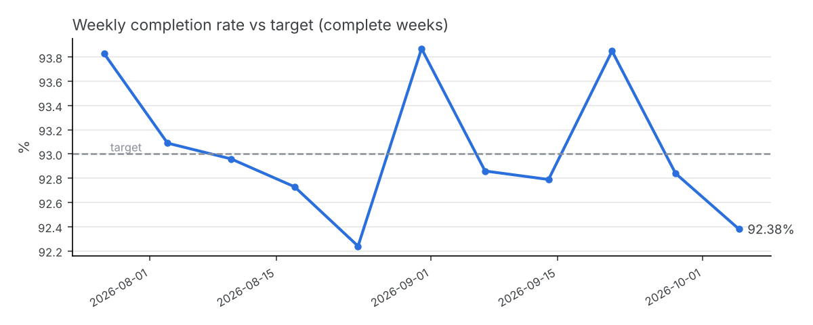
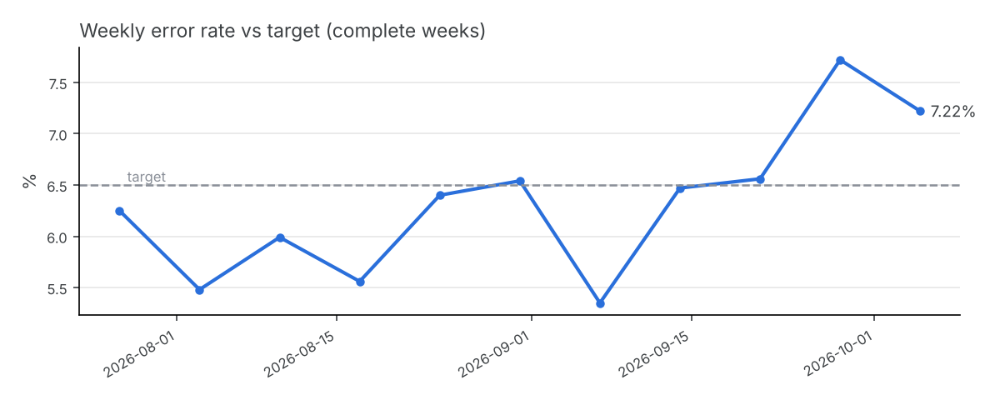
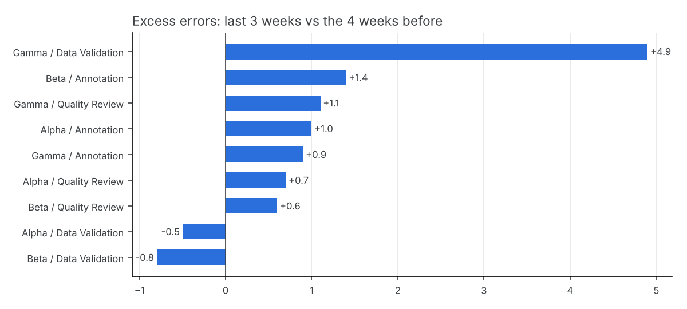

# Weekly Business Review

**Week of 05 Oct 2026** (latest complete week)

- Completion rate 92.38% (-0.46 pp WoW), missed the 93.00% target.
- Error rate 7.22% (-0.50 pp WoW), missed the 6.50% target; above target in 3 of the last 3 weeks (4-week average 6.99%).
- Main driver: Gamma / Data Validation. Its error rate went from 10.39% (prior 4 weeks) to 20.41% (last 3 weeks), explaining 46% of the extra errors. Next step: check for a guideline or tooling change in this workflow.
- Week of 12 Oct has only 2 of 5 working days, so it is shown but not compared WoW.
- Data quality: 4 of 517 raw rows were excluded after 5 failed checks (duplicate_task_id, impossible_total, missing_critical_field, negative_count).
- v1 reconciliation: 13 of 17 published v1 figures match.
  The 4 mismatches are all in the Weekly_Metrics tab: it divides errors by tasks assigned, while the rest of v1 divides by tasks completed. Fix that tab's formula.

_Synthetic data for demonstration. Generated by `refresh_wbr.py`._
